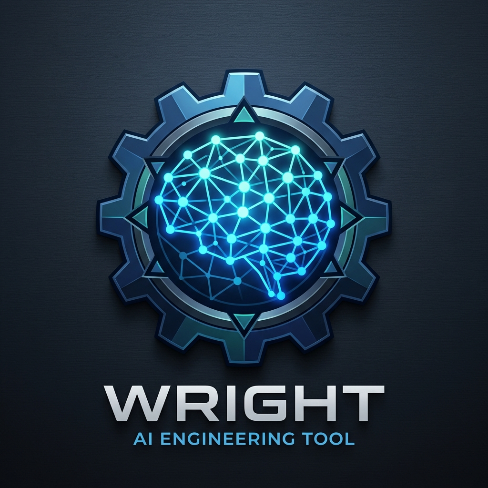

<p align="center">
  
</p>

<h1 align="center">Wright</h1>

<p align="center">
  <strong>Public-alpha, local-first agent orchestration for physical engineering.</strong>
</p>

<p align="center">
  <a href="https://github.com/burhop/wright/actions/workflows/ci.yml?query=branch%3Amain"></a>
  <a href="LICENSE"></a>
  <a href="https://www.python.org/downloads/"></a>
  <a href="docs/using-wright.md"></a>
  <a href="https://github.com/burhop/engineering-process-spec"></a>
  <a href="https://github.com/burhop/wright/discussions"></a>
  <a href="https://github.com/burhop/wright"></a>
</p>

<details>
<summary>Builds, packages and tooling for earlier Wright releases</summary>

The [earlier releases](https://github.com/burhop/wright/releases) shipped the [wright-engineering package on PyPI](https://pypi.org/project/wright-engineering/) and the [Wright container image on GHCR](https://github.com/burhop/wright/pkgs/container/wright). Their frontend used [Node.js 22+](https://nodejs.org/).

View the archived workflows for [Python CI](https://github.com/burhop/wright/blob/4f370caa9743f869f769f8c8e2332b6b63be438b/.github/workflows/python-quality.yml) · [Frontend CI](https://github.com/burhop/wright/blob/4f370caa9743f869f769f8c8e2332b6b63be438b/.github/workflows/frontend-quality.yml) · [OCI pull request validation](https://github.com/burhop/wright/blob/4f370caa9743f869f769f8c8e2332b6b63be438b/.github/workflows/docker-pr.yml) · [Docs](https://github.com/burhop/wright/blob/4f370caa9743f869f769f8c8e2332b6b63be438b/.github/workflows/docs-deploy.yml) · [Security scan](https://github.com/burhop/wright/blob/4f370caa9743f869f769f8c8e2332b6b63be438b/.github/workflows/public-alpha-safety.yml) · [Release](https://github.com/burhop/wright/blob/4f370caa9743f869f769f8c8e2332b6b63be438b/.github/workflows/release.yml).

</details>

---

Wright runs engineering workflows written in `.workflow.wflow` files. A workflow names the tools to call, their inputs and outputs, and the connections between steps. You supply the Model Context Protocol (MCP) servers. Wright checks the definition, calls the configured tools in order, and records which output each step consumed.

The included example measures the distance between two points. One MCP server writes the coordinates `(0, 0)` and `(3, 4)` in millimetres. A second server reads the file and returns **5 mm**. Both servers run locally. Once installed, the example runs offline without an account or language model.

## Run the example

Use **Python 3.11 or newer**. From the GitHub source view containing this README, choose **Code → Download ZIP** and extract it, or use your Git checkout. Open a terminal in the directory containing `pyproject.toml` and `examples/handoff`.

Create and activate a virtual environment. On Windows, check that `python --version` reports Python 3.11 or newer. If you installed a supported version through the Windows Python launcher, you can select it explicitly, for example with `py -3.13 -m venv .venv`.

| Platform | Create | Activate |
| --- | --- | --- |
| Windows PowerShell | `python -m venv .venv` | `.\.venv\Scripts\Activate.ps1` |
| macOS or Linux | `python3 -m venv .venv` | `. .venv/bin/activate` |

Then run these commands from the same directory.

```shell
python -m pip install .
python examples/handoff/configure.py bindings.json
wright-workflow parse examples/handoff/length.workflow.wflow
wright-workflow run examples/handoff/length.workflow.wflow --bindings bindings.json --run-dir runs/length
```

`configure.py` writes local bindings for the two example servers using the active Python environment. `parse` prints the source digest, ordered blocks, ports and required features. `run` invokes the tools and prints a JSON receipt.

In the receipt, look for `"status": "completed"` and `"length_mm": 5.0` under `ports["reader.measurement"].value`. Open `runs/length/files/points.csv` to see the 18 bytes that the reader measured. Its SHA-256 appears on both the writer’s output and the reader’s consumed input. Running the same command again returns the recorded result. Choose a fresh run directory for a new measurement. [Example workflow and providers](examples/handoff)

## Use Wright with your own tools

Write or obtain a workflow, configure the named MCP servers in a local bindings file, and supply JSON inputs for any declared input blocks. Wright also reads a `wright.workflow-bundle/1` JSON document containing the source and its declared dependencies. The CLI and Python API use the same parser and executor. [Inputs, tool bindings, Python API and resuming a run](docs/using-wright.md)

## How Wright relates to the format standard

The **Engineering Process Specification** is the draft interchange standard. It describes what an engineering process should preserve when it moves between tools. **Wright** is an MIT-licensed implementation with a documented executable subset. Its profile defines the source and bundle formats Wright reads today. The bundled schemas, example and conformance tests give other implementers concrete files and expected results. Independent interoperability remains an open milestone.

- [Engineering Process Specification and current draft](https://github.com/burhop/engineering-process-spec)
- [Wright executable profile](FORMAT.md) · [JSON schemas](src/wright_workflow/schemas) · [Conformance tests](tests)
- [MIT license](LICENSE) · [Historical Wright releases](https://github.com/burhop/wright/releases)
