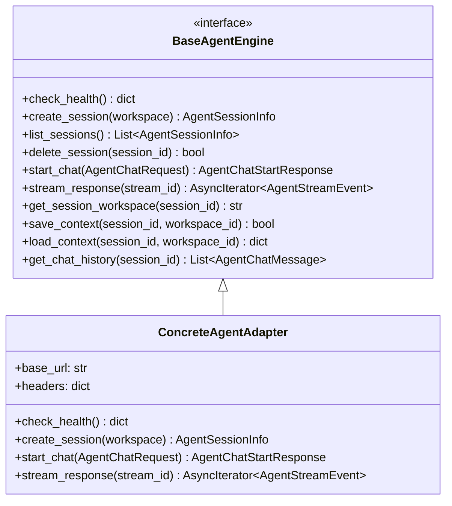

# Agent Adapters & Multi-Agent Orchestration

Wright implements an **Adapter Pattern** (`BaseAgentEngine`) to decouple the API gateway from the underlying LLM serving infrastructure. Hardcoding prompts or model-specific APIs is strictly forbidden. This abstraction allows the platform to support any local or remote inference engine depending on the deployment constraints and hardware capabilities.

## LLM Agnosticism and Configuration

The [workflow platform vision](../design/workflow-platform-vision.md#ai-authoring-through-wright)
also defines a configurable coding-agent role for UI creation through Wright.
The initial path uses the configured default model and versioned Wright API/UI
instructions. Map the role/profile into existing configuration and adapters.
The role describes its job, model, instructions, and allowed capabilities; the
agent platform provides its execution environment. Hermes is the current path,
with other platforms qualified separately rather than assumed equivalent.
Feature 083 implements a local `process-ui-author/1` path through this boundary.
Actual configured-model preview/save/update and saved reuse have recorded
evidence; complete feature/distribution acceptance remains pending. The
manager-specific examples below do not make each platform an immutable
engineering role or qualify it for scoped UI authoring.

### Qualified process UI coding role

`CodingRole` separates the role/profile, versioned instruction identity, repair
budget and model selection from the platform adapter. The initial path inherits
the configured default model; UI creation does not change global chat/model/tool
settings. The adapter must attest effective instructions on every turn, no
authoring tools and default-model inheritance through
`get_invocation_capabilities`. General chat health alone is insufficient.

Wright resolves the role with the accepted process bindings, public client/kit
documentation and packaged reference. It records adapter/model/configuration
and effective instruction digests in the durable job and immutable revision.
The model returns a bounded frontend envelope. Wright validates bindings and
uses its fixed compiler; it does not accept model package scripts, backends,
shell commands or a new runtime executor. At most two recorded diagnostic
repairs are allowed. Generated-interface process grants are separate from the
author's no-tools invocation.

Hermes is the locally verified adapter path. Other adapters/platforms or model
overrides need independent capability qualification; being named in this
architecture document is not proof of scoped authoring support. See
[process working interfaces](../workflows/process-working-interfaces.md), the
[public authoring resource](../../packages/workspace_service/src/workspace_service/process_interfaces/resources/public-api.md)
and [actual-model evidence](../../specs/083-process-working-interfaces/evidence/live-ui-authoring.md).

The agent adapter layer bridges the system to any target LLM provider:

*   **Local Inference**: Can connect directly to locally hosted engines via standard local APIs (e.g., Llama.cpp, Ollama, local WebUI backends), keeping model traffic on infrastructure the operator controls.
*   **Remote / Cloud Inference**: Can connect to remote enterprise cloud LLM endpoints, utilizing API keys and secure tokens.
*   **SSE Streaming**: Natural language tokens, tool call invocations, and progress messages are streamed asynchronously using Server-Sent Events (SSE).
*   **Context Persistence**: Workspace-specific agent configurations and conversation histories are serialized and persisted in the local SQLite database (`agent_contexts`), allowing users to restore previous states instantly.

## Per-Agent Risk Profiles & Guidance

The following deployment profiles describe operational conventions. They are
not permanent platform-to-role assignments and do not establish capability
qualification for process UI creation:

### Hermes (Coordination & Task Routing)
*   **Risk Level**: Low
*   **Focus**: Reads and writes structured task trees, manages inter-agent message routing, and presents summaries.
*   **Constraints**: Do not install communication libraries system-wide. Write all message queues, logs, and routing tables to `/home/hermes/`. Do not modify `/etc/hosts` or network configuration without explicit operator instruction.

### OpenClaw (System Operations & Tool Execution)
*   **Risk Level**: High
*   **Focus**: Executes shell utilities, interacts with CAD/CAM engines directly, and configures environments.
*   **Constraints**: Treat every system-level action as potentially irreversible. Log before executing, not after. For any change to `/etc`, always create a timestamped backup in `/home/agent/.backups/etc/` first. When in doubt between a system-level and user-space solution, always choose user-space.

### Pi (Analysis & Computation)
*   **Risk Level**: Medium
*   **Focus**: Installs scientific packages and handles heavy calculations, dataset processing, and math/physics solvers.
*   **Constraints**: All package installation via micromamba to `/opt/conda`. Do not use system pip. Write all intermediate computation outputs to `/home/pi/scratch/` rather than `/tmp` (which is ephemeral). Large datasets should go to `/home/pi/data/` to persist across sessions.
