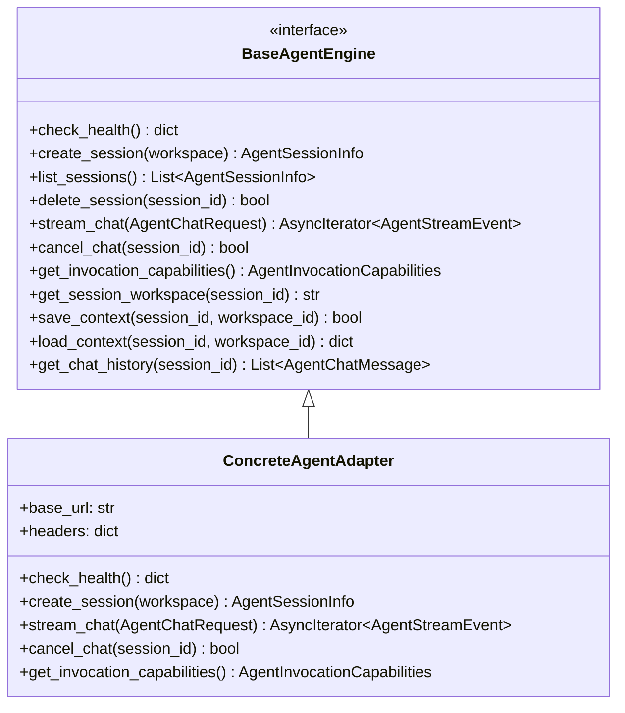

# Agent Adapters & Multi-Agent Orchestration

Wright uses `BaseAgentEngine` and `AgentEngineRegistry` to separate its API/runtime
from the selected agent platform. Platform-specific transport belongs in adapters.
Workflow behavior belongs in inspectable versioned instruction assets and accepted
source; permissions and validation remain backend-owned. Adding an adapter requires
capability qualification for the operations it claims to support.

## LLM Agnosticism and Configuration

The [workflow platform vision](../design/workflow-platform-vision.md#ai-authoring-through-wright)
also defines a configurable coding-agent role for UI creation through Wright.
The initial path uses the configured default model and versioned Wright API/UI
instructions. Map the role/profile into existing configuration and adapters.
The role describes its job, model, instructions, and allowed capabilities; the
agent platform provides its execution environment. Hermes is the current path,
with other platforms qualified separately rather than assumed equivalent.
Feature 083 implements a local `process-ui-author/1` path through this boundary.
Actual configured-model preview/save/update and saved reuse have recorded
evidence, including installed saved-interface reuse. The
[completion audit](https://github.com/burhop/wright/blob/dev/specs/083-process-working-interfaces/completion.md)
records the bounded local feature scope; release and user acceptance are separate. The
manager-specific examples below do not make each platform an immutable
engineering role or qualify it for scoped UI authoring.

### Qualified process UI coding role

`CodingRole` separates the role/profile, versioned instruction identity, repair
budget and model selection from the platform adapter. The initial path inherits
the configured default model; UI creation does not change global chat/model/tool
settings. The adapter must attest effective instructions on every turn, no
authoring tools and default-model inheritance through
`get_invocation_capabilities`. General chat health alone is insufficient.

Wright resolves the role with the accepted process bindings, public client/kit
documentation and packaged reference. It records adapter/model/configuration
and effective instruction digests in the durable job and immutable revision.
The model returns a bounded frontend envelope. Wright validates bindings and
uses its fixed compiler; it does not accept model package scripts, backends,
shell commands or a new runtime executor. At most two recorded diagnostic
repairs are allowed. Generated-interface process grants are separate from the
author's no-tools invocation.

Hermes is the locally verified adapter path. Other adapters/platforms or model
overrides need independent capability qualification; being named in this
architecture document is not proof of scoped authoring support. See
[process working interfaces](../workflows/process-working-interfaces.md), the
[public authoring resource](https://github.com/burhop/wright/blob/dev/packages/workspace_service/src/workspace_service/process_interfaces/resources/public-api.md)
and [actual-model evidence](https://github.com/burhop/wright/blob/dev/specs/083-process-working-interfaces/evidence/live-ui-authoring.md).

The agent adapter layer bridges the system to any target LLM provider:

*   **Local Inference**: Can connect directly to locally hosted engines via standard local APIs (e.g., Llama.cpp, Ollama, local WebUI backends), keeping model traffic on infrastructure the operator controls.
*   **Remote / Cloud Inference**: Can connect to remote enterprise cloud LLM endpoints, utilizing API keys and secure tokens.
*   **SSE Streaming**: Natural language tokens, tool call invocations, and progress messages are streamed asynchronously using Server-Sent Events (SSE).
*   **Context Persistence**: Workspace-specific agent configurations and conversation histories are serialized and persisted in the local SQLite database (`agent_contexts`), allowing users to restore previous states instantly.

## Implemented runtime support

As of 10 October 2026, the default registry declares:

| Runtime | Current code support |
| --- | --- |
| Hermes | Supported default, with the qualified invocation paths described above. |
| OpenClaw | Known but unavailable. `OpenClawStubEngine` reports disconnected and cannot execute real chat. |
| Pi | Known but unavailable; no executable provider is registered. |
| Codex as Wright's agent runtime | Separate planned project; not registered by the current implementation. |

The existing [Codex MCP connection](../getting-started/codex.md) lets an external
Codex client use Wright tools. It does not replace Wright's internal Hermes agent.
Selecting an unavailable runtime fails explicitly. A model name, healthy chat
endpoint or external MCP connection cannot establish UI-authoring or workflow
invocation support on its own.

The implementation source is the
[agent registry](https://github.com/burhop/wright/blob/dev/packages/agent_adapters/src/agent_adapters/registry.py)
and [base contract](https://github.com/burhop/wright/blob/dev/packages/agent_adapters/src/agent_adapters/base.py).
