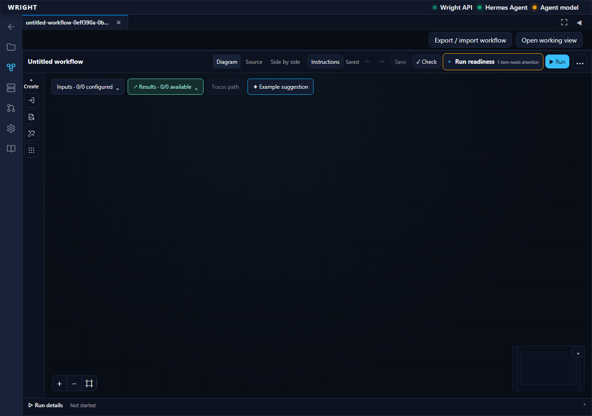
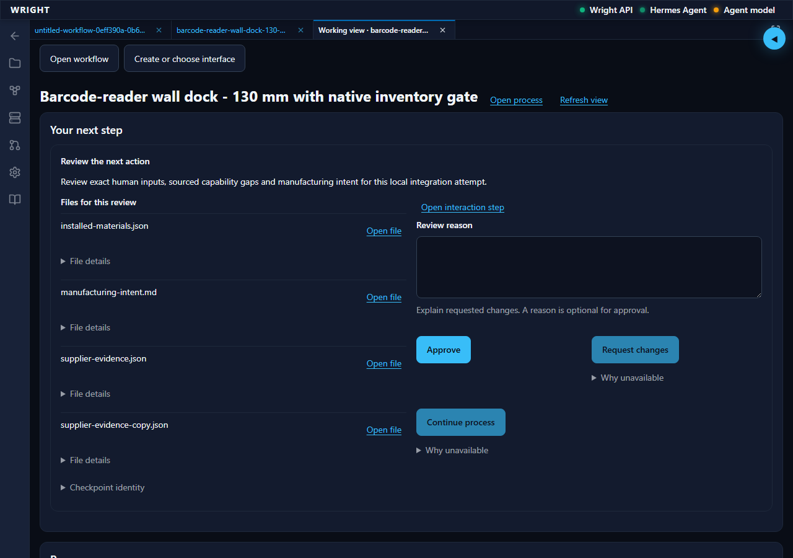

# An engineering process in Wright

This tour describes the current development source, checked on 10 October 2026.
Use the [working-view setup](process-working-interfaces.md#current-source-setup)
for build flags and provider prerequisites. The examples illustrate digital
engineering studies; their review holds remain visible and are not release approval.

## 1. Build the process

Choose **Workflows** in a workspace to begin with a blank canvas, or open a saved
`.workflow.wflow` file. Add the inputs, engineering tasks and decisions the job
needs. Select actual workspace MCP providers and connect typed outputs to the
next step. The diagram, source and inspectors edit one accepted definition.
Save before opening its working view.

A useful mechanical example hands a native CAD model to an independent geometric
check, then to a manufacturing-appropriate preparation step. A sheet-metal route
needs a developed flat and bending checks; an additive route needs its own material,
orientation and slice checks. They are separate engineering processes.

*New workflows start blank. Existing files are opened explicitly.*

## 2. Prepare and follow the job

**Open working view** presents inputs and readiness for a new run. Supply required
values and files; resolve missing providers and configuration before **Start**.
Some required data can be produced by declared upstream steps. Model-generated
choices follow the saved assumption policy and must remain distinguishable from
requirements supplied by the engineer.

For an existing run, use **Run details → Previous runs → Open run in working view**.
Both views refer to that exact run. Closing a tab is not cancellation; reopening
reconciles with the backend's recorded state. An operation reporting completion
is distinct from the process passing its output checks.

## 3. Inspect the evidence

Open an output using **Open file** or its result-card viewer. Wright supports
formatted engineering documents, images, supported geometry and toolpaths,
PDF drawings, numerical tables and plots. The available view depends on the
file's supported format. Use **Download exact file** for the recorded bytes.

Validation findings identify their check, requirement, observed evidence and
result. Follow the producing-step and attachment links to inspect the basis.
**Previous attempts** retains earlier evidence after a correction; a later result
does not erase the failed attempt. A file's existence or a plausible rendering
alone does not establish dimensions, fit, strength or manufacturability.

## 4. Make deliberate decisions

At **Request input**, provide the requested information. At an engineering review,
inspect the exact referenced outputs before responding. Answers, reviews and
external-action approvals are separate authorities. A changed artifact or definition
can invalidate an earlier decision; it is not silently reused.

The mechanical and thermal studies have retained digital results and required
human review. The separate 130 mm sheet-metal dock is still an unfinished study:
its latest run waits at intent review; native manufacturing deliverables are not
complete. Its source also has an editor port-type finding that remains visible.
The reviewed swim-lane demonstration is still pending integration. None of these
items should be presented as completed engineering qualification.

*Actual saved-run review in the current UI. Opening or reloading this view submitted no answer, approval or continuation.*

## 5. Reuse and tailor the experience

In the working tab, **Create or choose interface** can ask Wright's configured
coding role for a job-specific interface. Preview and save it, then reuse the
saved revision on compatible runs. The common view remains available when a
tailored interface cannot be used. The generated interface uses Wright's process
client and UI kit; execution and decision authority remain with Wright services.

Export a workflow to transfer its saved instructions and supported dependencies.
The receiving workspace must qualify its own providers and rebuild imported
interface source. It does not inherit the original user's credentials or approvals.

## Further reading

- [Working interfaces and exact controls](process-working-interfaces.md)
- [Output validation and review boundaries](process-output-validation.md)
- [Workflow template catalog and readiness](engineering-workflow-templates.md)
- [Current implementation and remaining work](https://github.com/burhop/wright/blob/dev/specs/083-process-working-interfaces/mechanical-engineering-execution.md)

Screenshots were captured from production preview build 47 on 10 October 2026.
They show the actual served UI and contain no authentication token. The
[image provenance](../images/workflows/capture-provenance.json) records source and hashes.
The linked run and provider configuration are local test data, not bundled user data.
