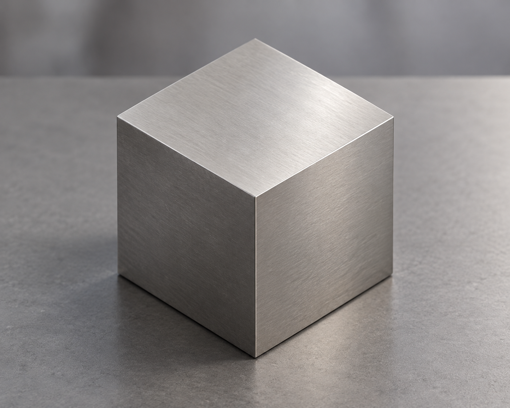
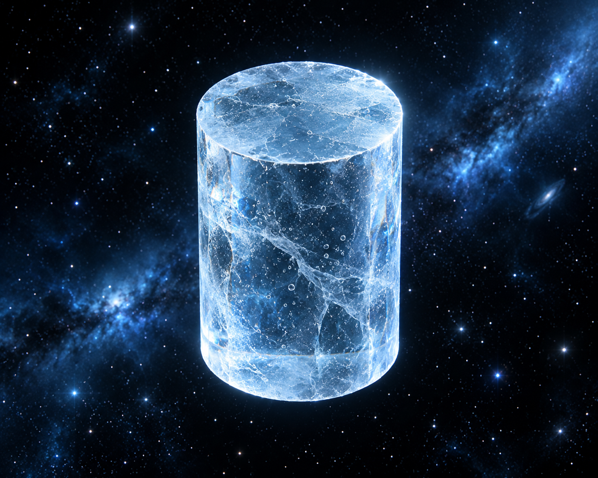

# Shape-to-image regression examples

Two text inputs, one reusable four-block workflow: shape description → SteveCAD geometry and capture; rendering description plus that actual capture → generated image.

| Case | Shape | Appearance | Observed execution time |
|---|---|---|---:|
| Cube | Create a cube | Render it as titanium on a table | 2m04s |
| Cylinder | Create a cylinder | Render it as ice floating in space | 2m05s |
| Repeat cube | Create a cube | Render it as titanium on a table | 1m34s |

The beta tester ran and inspected all three through Wright's normal browser UI without intervening developer changes. Each image-generation request contained its corresponding actual CAD capture. These are prepared use/reuse observations; they do not qualify installation, fresh authoring or physical engineering correctness. Detailed laboratory records remain local.

Local merge-gate limitation (31 October 2026): on the ARM64 host with a 64 KB page-size kernel, the full browser run reported 162 passes, five skips and 18 WebKit launch failures. WebKit initially lacked GStreamer and AVIF libraries; after supplying them in an isolated copy it still aborted at startup. The cause of that abort is not established. Chromium, Firefox and desktop-browser cases completed, but WebKit remains unverified locally and requires the full browser CI gate on a supported host.

For regression execution, use [the exact saved workflow](saved-workflow.wflow) and [the case definitions](regression-cases.json). Connect authorized SteveCAD and a supported image-generation model, then run cube → cylinder → cube through the same saved workflow, changing only the two inputs. Open the actual captures and final images. Inspect normal run evidence for the capture handoff. No customer code or configuration repair, and no pixel-identical generative-image comparison.

