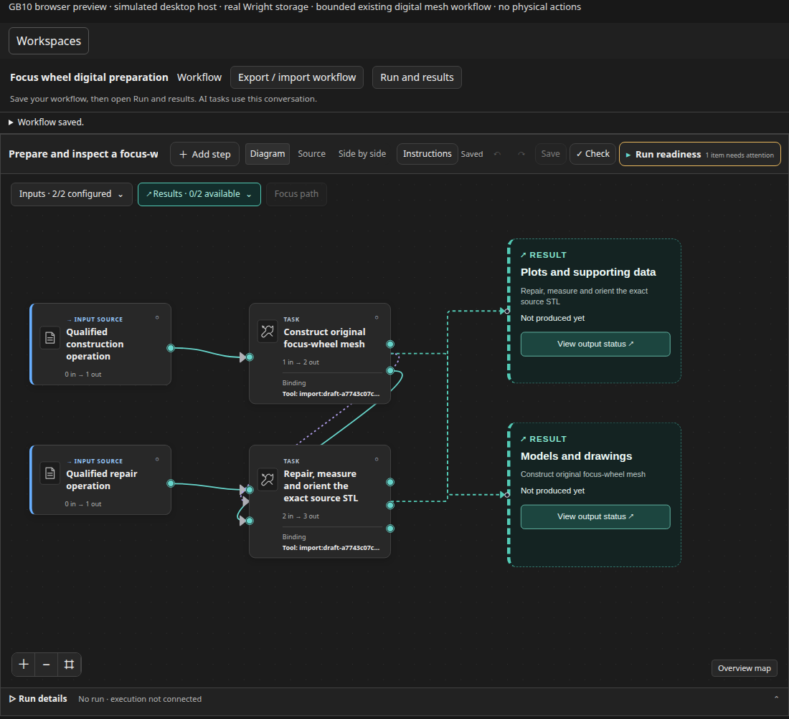
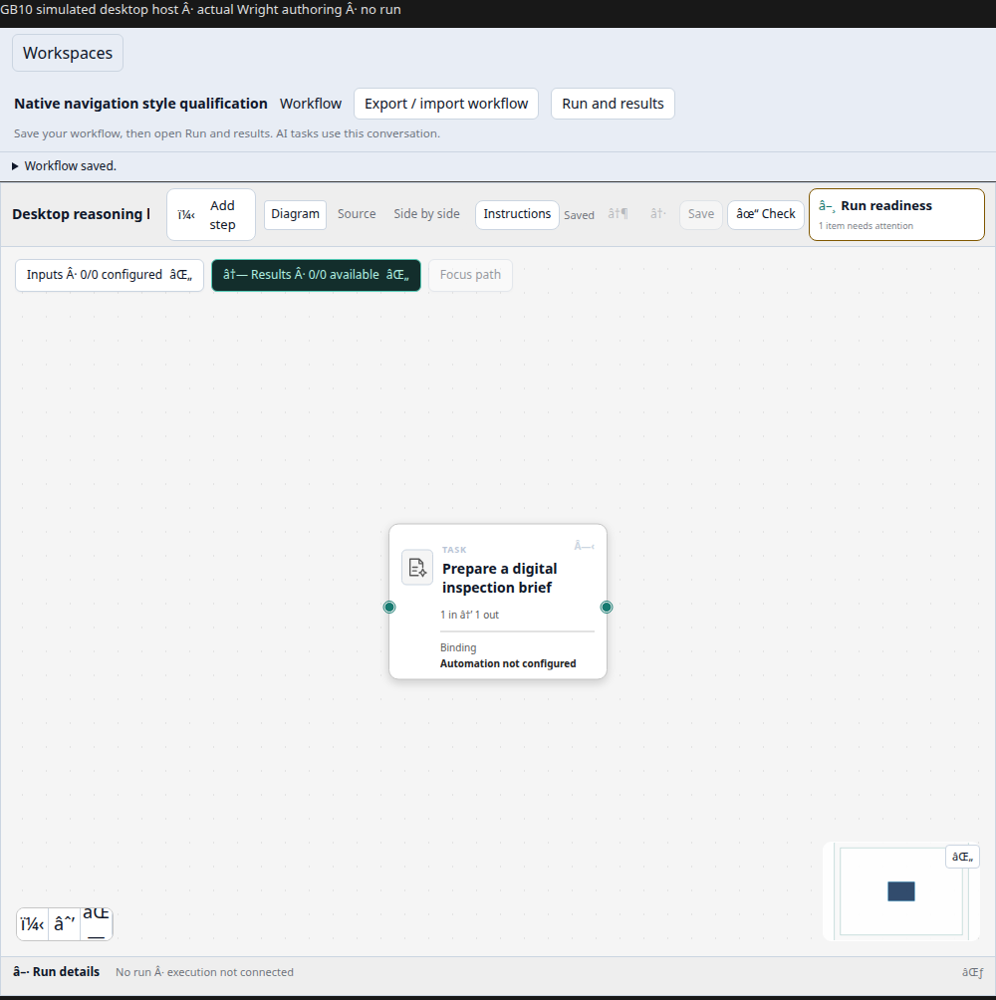

# Unpublished prototype progress

These are real captures of the current Wright native resource in a **simulated
GB10 browser host**, not Windows desktop screenshots. No public posting is authorized.

Suggested caption: “Wright's shared engineering canvas now fits beside the
desktop conversation. The bounded focus-wheel integration check used two real
Blender operations with an exact STL handoff and independent mesh checks.
Experimental prototype; shown here in our GB10 browser test host.”

The capture shows reopening the accepted definition; its canvas badges are not
the completed run. The recorded run/result proof is separate. No manufacturing,
strength, fit, printing, human acceptance or Windows qualification is implied.

Suggested caption: “One shared workflow canvas, with a surrounding frame that
follows the host's theme and typography. Wright keeps execution, permissions,
review and recovery; the desktop harness supplies the conversation and reasoning.”

Exact image hashes and origins: [capture evidence](gallery/desktop-015-capture-evidence.json).
For a later Windows capture, use the fresh-chat walkthrough after checking the
actual panel; do not present these browser previews as desktop acceptance.
