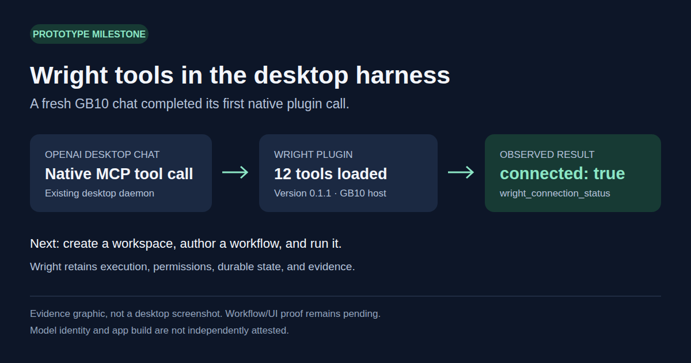
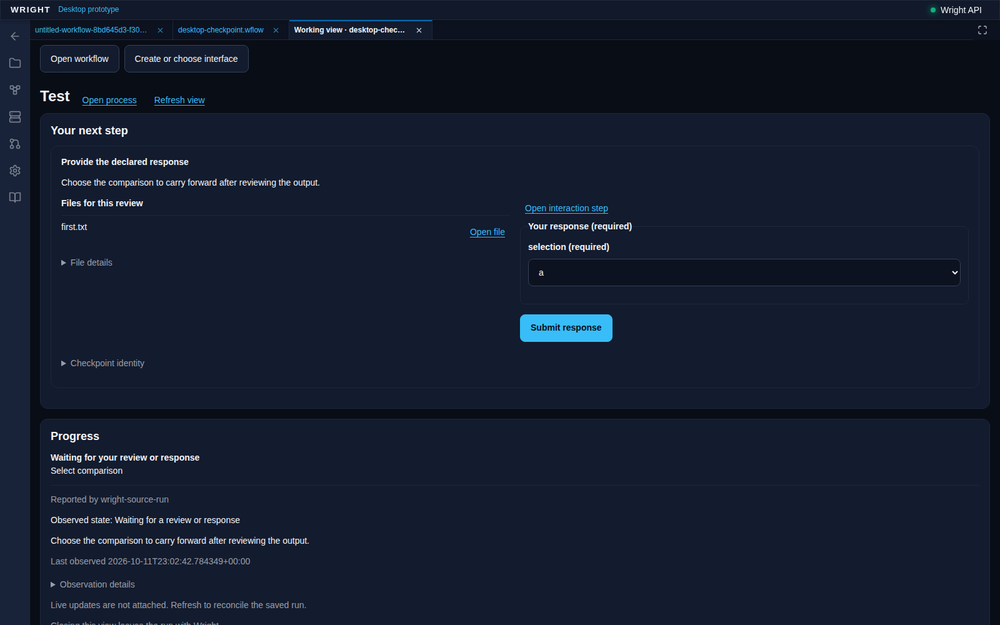
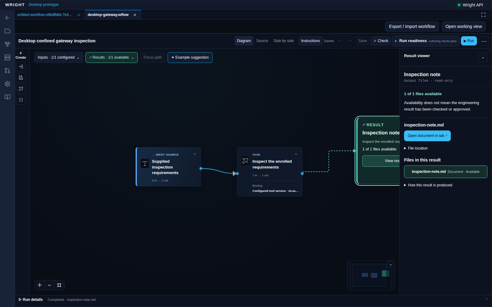

# Working prototype gallery

Image 11 is a labelled evidence graphic for a verified native tool call. The
other images are actual GB10 browser captures of served Wright, rather than
desktop chrome. No image establishes Windows right-panel acceptance. Clean
isolated data; no credentials or unrelated private conversation content appear.

## Native desktop plugin connection

Suggested caption: "First native connection: Wright tools are now callable from
a fresh OpenAI desktop chat on GB10. Workflow and UI qualification comes next."

The fresh app-visible desktop chat completed the actual installed MCP connection
tool with `connected: true`; twelve tools loaded. This is an evidence graphic,
not a screenshot of the desktop. No workspace/run was created during the initial
check. Model identity/app build remain unreported to Wright. Native source:
11-native-plugin-connected.svg; reduced record: ../native-fresh-chat-evidence.json.
Next preferred image: the fresh desktop chat beside Wright after actual workflow
authoring/rendering, excluding unrelated chat content and all credentials.

## Connected declared input

Suggested caption: "Wright pauses for declared input and carries your response
into the same run."

The actual hosted browser enabled this required input and submitted its synthetic
choice through the normal common view. Wright passed that exact value to the
desktop's next bounded task and completed the original run, retaining the first
output after an isolated API restart. Reopening/reloading/closing the completed
common view was verified separately. The initial capture's final-text selector
failure remains labelled; no input was resubmitted to obtain the readback pass.
This is synthetic test data and ordinary GB10 browser proof. It establishes no
engineering approval, Windows plugin loading, native right panel or attached
live-event stream. Completed readback: 10-completed-checkpoint-run.png.

## Leased runtime and saved gateway result

Suggested caption: "Connecting desktop reasoning to Wright’s workflow controls,
with saved results and clear tool boundaries."

This actual current-worktree browser view shows the completed permitted file
inspection and retained result. The desktop conversation proposed the read and
used its observed return; Wright performed the one authorized gateway dispatch.
A separate no-tools run also survived actual MCP child loss and reconnect, with
its original request retained and one consumed reply. The screenshot is the
gateway result, not an image of that separate disconnect event or the Windows
desktop. Installed plugin, right-panel rendering and actual chat/panel closure
remain unverified. Capture trace: leased-gateway-capture.json.

## Current hosted authoring checks

Suggested caption: "Preparing Wright for a single-chat desktop experience:
workflow editing and saved diagrams stay in Wright."

The browser created and configured this fresh definition, made an exact typed
connection, rejected an incompatible one, dragged/panned/zoomed, used Undo/Redo
and reopened identical source/layout. A continuation rejected a managed-field
source draft, protected a real stale-save conflict and verified compact layout.
Eleven focused cases now pass together in report 09; earlier staged evidence is
retained. No agent/inference or run API
was called. This is authoring proof, not execution, installed Windows loading,
desktop chrome or right-panel acceptance. The document remains visibly unbound.
Reduced evidence: ../qualified-authoring-evidence.json.

## Completed desktop reasoning task

Suggested caption: "Testing Wright with the OpenAI desktop harness: the desktop
agent supplies reasoning, while Wright keeps the workflow, execution and
evidence."

Proves: the existing editor displays an accepted workflow and its completed
inspection-brief result. This desktop conversation authored the reply; the MCP
protocol client transported it and Wright's canonical runtime saved the output.
The capture entered through the normal workspace Workflows control. It made no
standalone agent/inference API requests.

## Exact result navigation

Suggested caption: "A desktop-agent answer becomes a saved Wright result, with
its original workflow and run still attached."

Proves: the real editor links the output to its result viewer and offers the
saved document. No engineering inspection or manufacturing approval is claimed.

Limitations for both images: installed desktop-plugin loading and right-panel
rendering are not yet demonstrated. These first images alone do not prove gateway
work or continuation; the separate proofs below and in the evidence index do.

Capture details and request trace: [capture.json](capture.json). Run:
`ef1ba07937a74281a7fe165af18ef250`; source:
`workflows/desktop-inspection.workflow.wflow`; workspace:
`59bc92bd-e5bb-4f52-9a9c-2dce30d05a43`. The subject is the current dirty
prototype worktree on `ba2fad68`, not a released or committed build.

## Desktop proposal, permitted gateway inspection, retained result

Suggested caption: "Prototype progress: the OpenAI desktop agent proposes an
inspection, Wright executes the permitted operation, and the workflow retains
the result and evidence."

Proves: the accepted source reads the supplied requirements through Wright's
existing file-inspection gateway under an exact private integration grant. The
desktop supplied both action decisions over the pinned MCP protocol. The same
run completed after its controller disconnected, with exactly one successful
inspection dispatch and an unchanged input. The viewer preserves the distinction
between an available result and engineering approval.

These are actual browser captures through Workflows, not native desktop chrome
or installed-plugin evidence. No physical measurement or manufacturing release
is claimed. Run `5a9f0dedc8b84aba931ad251e27ebf00`;
[capture details](gateway-capture.json);
[reduced qualification evidence](../qualified-gateway-evidence.json).
