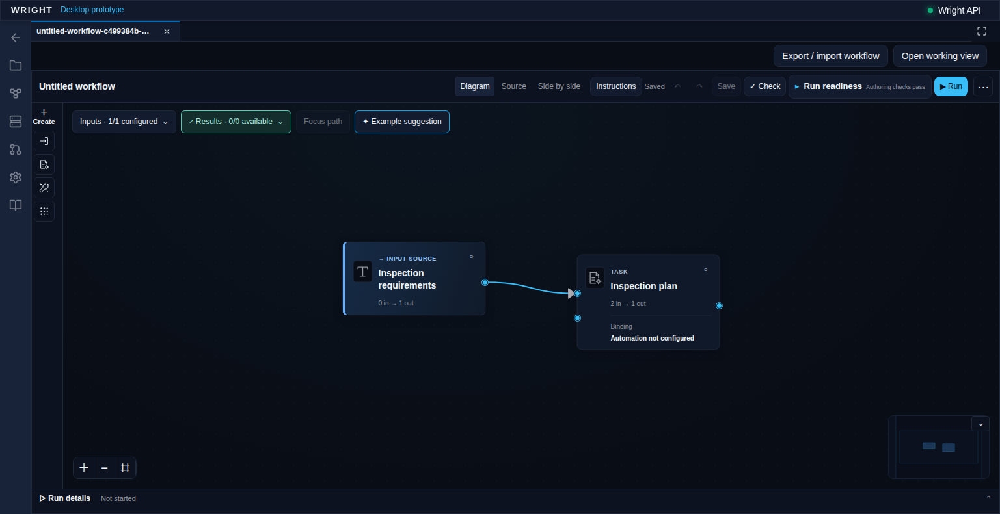
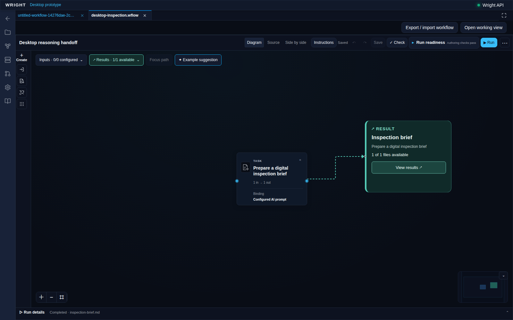
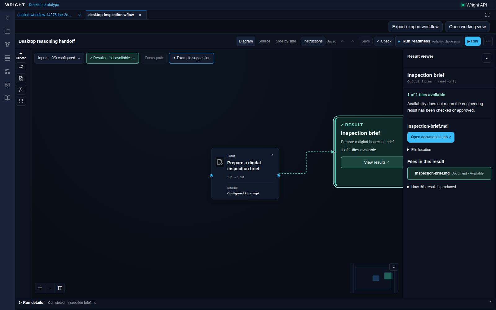
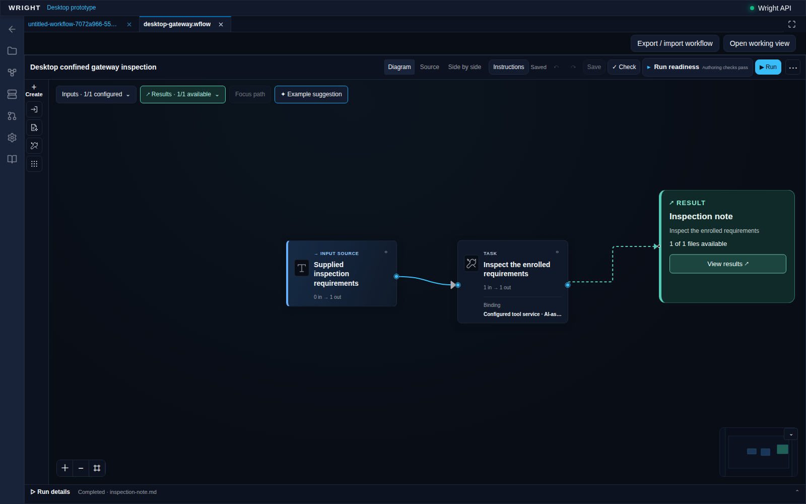
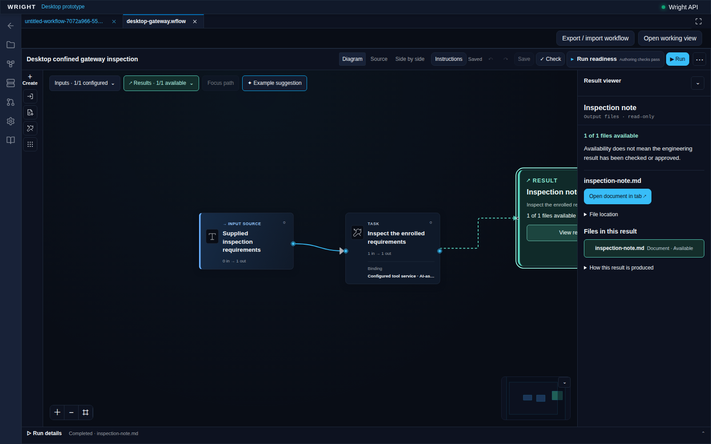

# Working prototype gallery

These are actual GB10 browser captures of the served hosted Wright UI, not
concept art or screenshots of the desktop application's chrome. Clean isolated
demonstration data; no credentials or private chat content appear.

## Current hosted authoring checks

Suggested caption: "Preparing Wright for a single-chat desktop experience:
workflow editing and saved diagrams stay in Wright."

The browser created and configured this fresh definition, made an exact typed
connection, rejected an incompatible one, dragged/panned/zoomed, used Undo/Redo
and reopened identical source/layout. A continuation rejected a managed-field
source draft, protected a real stale-save conflict and verified compact layout.
Eleven focused cases now pass together in report 09; earlier staged evidence is
retained. No agent/inference or run API
was called. This is authoring proof, not execution, installed Windows loading,
desktop chrome or right-panel acceptance. The document remains visibly unbound.
Reduced evidence: ../qualified-authoring-evidence.json.

## Completed desktop reasoning task

Suggested caption: "Testing Wright with the OpenAI desktop harness: the desktop
agent supplies reasoning, while Wright keeps the workflow, execution and
evidence."

Proves: the existing editor displays an accepted workflow and its completed
inspection-brief result. This desktop conversation authored the reply; the MCP
protocol client transported it and Wright's canonical runtime saved the output.
The capture entered through the normal workspace Workflows control. It made no
standalone agent/inference API requests.

## Exact result navigation

Suggested caption: "A desktop-agent answer becomes a saved Wright result, with
its original workflow and run still attached."

Proves: the real editor links the output to its result viewer and offers the
saved document. No engineering inspection or manufacturing approval is claimed.

Limitations for both images: installed desktop-plugin loading and right-panel
rendering are not yet demonstrated. These first images alone do not prove gateway
work or continuation; the separate proofs below and in the evidence index do.

Capture details and request trace: [capture.json](capture.json). Run:
`ef1ba07937a74281a7fe165af18ef250`; source:
`workflows/desktop-inspection.workflow.wflow`; workspace:
`59bc92bd-e5bb-4f52-9a9c-2dce30d05a43`. The subject is the current dirty
prototype worktree on `ba2fad68`, not a released or committed build.

## Desktop proposal, permitted gateway inspection, retained result

Suggested caption: "Prototype progress: the OpenAI desktop agent proposes an
inspection, Wright executes the permitted operation, and the workflow retains
the result and evidence."

Proves: the accepted source reads the supplied requirements through Wright's
existing file-inspection gateway under an exact private integration grant. The
desktop supplied both action decisions over the pinned MCP protocol. The same
run completed after its controller disconnected, with exactly one successful
inspection dispatch and an unchanged input. The viewer preserves the distinction
between an available result and engineering approval.

These are actual browser captures through Workflows, not native desktop chrome
or installed-plugin evidence. No physical measurement or manufacturing release
is claimed. Run `5a9f0dedc8b84aba931ad251e27ebf00`;
[capture details](gateway-capture.json);
[reduced qualification evidence](../qualified-gateway-evidence.json).
