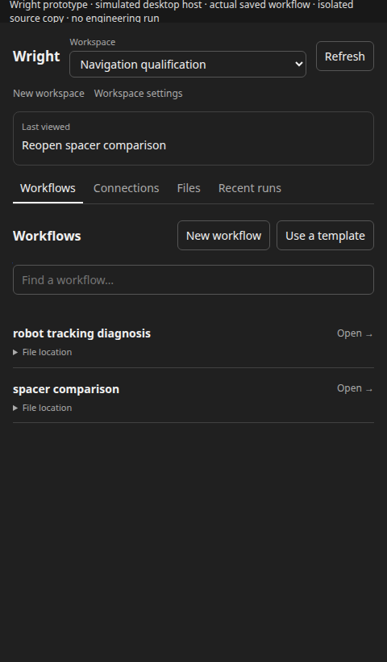
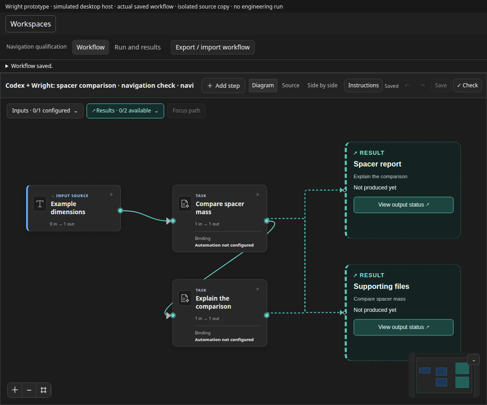
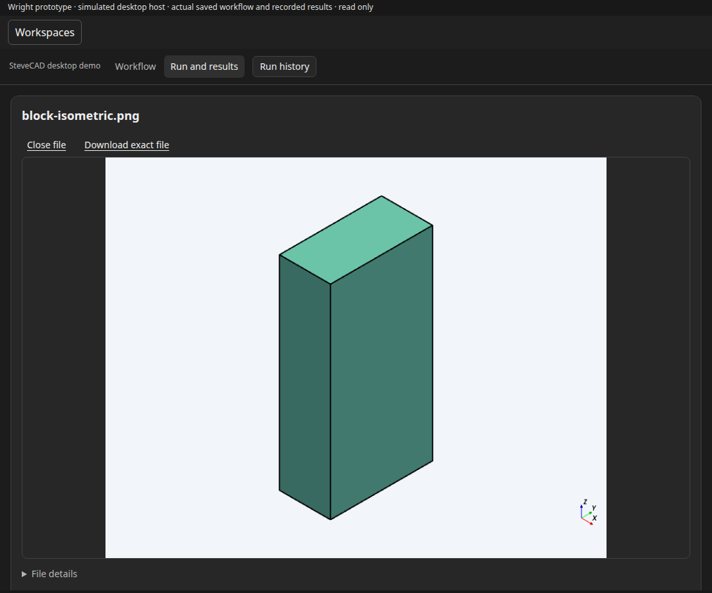

# Desktop workflow navigation prototype

Status: implemented and locally verified through the real MCP/source owner;
repository gates and actual Windows desktop acceptance pending. No live plugin update.
Branch: `codex/desktop-workflow-navigation`, from dev `40b6270e`.
The Windows routing/restart repair remains in PR #165 on its own branch.

## User journey

Choose a workspace, open a workflow, edit or inspect it, move to Run and results,
and return without losing which workflow/run is being inspected. Workspace tools,
files and settings remain accessible but do not dominate the engineering task.
The desktop conversation supplies chat; Wright supplies the shared canvas and
existing process views.

The user's 0.18 screenshots show excessive header/form space, unclear transitions
between workflow and run views, a tiny graph in the available canvas, and run
history that requires selecting an unrelated-looking filename. An editor saying
“execution not connected” beside a working Run and results view creates conflicting
signals. Existing backend fixes and saved engineering results are preserved.

## Small changes, in order

1. Render an early revision of the existing Home and workflow frame. Use a compact
   workspace bar, clear section navigation, searchable workflow rows, and a
   consistent Workflow / Run and results switch. Keep settings and transfer
   controls secondary. Reuse current components/tokens; no component library,
   docking system, extra sidebar, copied chat, or new host abstraction.
2. Keep exact workflow and run context visible through view changes. Reuse the
   existing widget navigation hints and model-context update; revalidate source,
   session and run through the existing clients before restoring them. A hint
   cannot start/resume work or grant permission. Preserve dirty/uncertain-save
   guards and explicit historical-revision handling.
3. Make results/history a continuation of the selected workflow. Reuse recorded
   run reads, common working view, artifact previews/downloads, exact block links,
   and unavailable-action explanations. Do not automatically select a different
   workflow or label a historical failed run successful.
4. Qualify the served Workflows entry, capture the real rendered revision, then
   run the applicable repository gates. Package a candidate only after focused
   user-journey checks pass. Actual Windows panel retention/rendering remains a
   separate observation; a simulated host is not desktop acceptance.

## Preserved boundaries

The neutral canvas, source, typed ports, undo/redo, inspectors, layout persistence,
drafts, save/reopen and conflicts retain their existing owners. Backend services
own readiness, permitted actions, durable state, reviews, validation and recovery.
Opening or closing a view does not run or cancel anything. Common UI remains the
fallback; generated process UI stays within its existing capability gates.
Hermes keeps its own chat and frame; these native-panel changes cannot rebind its
model/session or replace its editor. Future hosts remain unqualified.

## Checks and evidence to collect

- [x] Early rendered Home/editor at normal and narrow panel widths; no clipped
      controls or excessive nested headers. Label screenshots as prototype.
- [x] Home → Workflows → source/diagram → save/reopen; preserved authoring controls.
- [x] Editor → run/results → exact saved evidence → producing block → editor.
- [x] View/context survives supported remount; stale scopes and changed source
      produce an explicit hold. No automatic mutation on restoration.
- [x] Dirty and uncertain source/input saves retain their guards.
- [x] Fresh source-only copies of the existing mechanical example and Robot
      Tracking Diagnosis prove shared presentation without replaying engineering.
- [ ] Existing Hermes/shared editor regressions, native-panel tests, served
      entry walkthrough, required gates and Windows handoff.

## Implemented decisions and evidence

The native frame now has a compact workspace bar and searchable workflow rows.
Workflow / Run and results stays in the same position; run history is scoped to
the workflow already being viewed. The native composition hides only its unbound
editor run controls when the existing working view is available. Shared canvas
authoring controls and Hermes's bound run controls retain their owners.

Existing widget navigation hints now optionally identify a source digest, view
and run. Reopening is explicit and rereads the backend; source drift or an invalid
scope holds navigation. The hint contains no execution state or approval. A new
accepted source drops the prior run association. Historical evidence remains
read-only; attaching the working view requires the exact runtime-confirmed run.

The common view folds completed/cancelled progress details when there are no
diagnostics or pending/error reasoning signals. Results remain visible, and exact
run navigation expands the details. Active, waiting and failed-run diagnostics
retain their existing presentation and backend authority.

[Evidence index](evidence/navigation-20261020/evidence.json) records actual bundle,
source, run, report and image hashes. It projects the original local receipts;
it does not include credentials or duplicate workflow instruction bodies.

- 344 related native-panel/common-view/UI-kit tests pass; all 470 shared editor
  regression tests pass. TypeScript build and ESLint pass.
- The real source owner accepted explicit edits to fresh spacer and Robot Tracking
  Diagnosis copies. Engineering requirements were unchanged; neither workflow ran.
- The retained inspection-only CAD recovery run opens its actual PNG (matching
  the recorded checksum), links to its producing-step inspector, and returns to
  the same run. Source and recorded history remain unchanged.
- Loaded narrow Home, source/diagram, history and widget remount are checked by
  `native_navigation_acceptance.mjs`. The first narrow Home screenshots caught
  loading; the corrected check waits for actual workspace and workflow controls.
  Those early screenshots are not evidence for loaded layout acceptance.
- These checks simulate the desktop host. They do not establish actual Windows
  panel persistence, downloads, host outer-tab behavior, or user acceptance.

Rendered candidate, captured from real Wright-backed views in the simulated host:

## Remaining delivery tasks

1. Commit the bounded UI change and run the repository push/merge gates; retain
   native host limitations separately from CI and desktop acceptance.
2. Create a separate review candidate and record its exact source/bundle identity.
3. Qualify the installed candidate through the desktop Workflows entry. Check
   Home → workflow → results → producing block → same run, save/reopen and
   changed-source handling at realistic Windows panel widths. Reuse saved outputs;
   no CAD creation or historical-run replay is needed for UI acceptance.
4. Keep the Windows engineering pilot on its own qualified runtime. Its shared
   routing/restart fixes passed at d6eda2b4; the independent SteveCAD export error
   is a provider follow-up and does not justify changing this UI or runtime policy.

## Current official host guidance

OpenAI documents conversation panel entrypoints and host display modes in
[Plugin Extensions](https://developers.openai.com/plugins/build/extensions).
The installed bridge already declares a thread entrypoint; this work reuses it.
The [UI guidance](https://developers.openai.com/plugins/concepts/ui-guidelines)
supports compact focused controls and larger surfaces for diagrams.
[State guidance](https://developers.openai.com/plugins/build/chatgpt-ui#manage-state)
keeps authoritative data on the server and widget state as presentation hints.
These sources were fetched on 20 October 2026. They do not prove this Windows
build's tab persistence, nor give Wright ownership of the host's outer navigation.

## Pillow security qualification — 20 October

PR166's second CI cycle and merged dev `89a04bf9` encountered eight newly indexed
Pillow advisories after the earlier full gate passed. The runtime bounds and lock
now select 13.0.0; it is the only changed locked package version. The existing
Docker Hermes security override uses the same version, retaining exactly four
reviewed metadata conflicts. Image smoke checks the actual Pillow floor in both
Wright and Hermes; no vulnerability-policy exception is added.

Upstream [release notes](https://pillow.readthedocs.io/en/stable/releasenotes/13.0.0.html)
and all eight official advisory records identify 13.0.0 as patched. Its Python
3.11 minimum matches Wright. The current Python audit passes (101 distributions
including audit tooling). All 110 selected PDF/image transport, identity, limits,
redaction and container-contract checks pass. The sandboxed first attempt stalled
and was stopped; the host-permitted run passed in 9.85 seconds. Both are retained.

Exact local index: `/tmp/wright-desktop-navigation-gates-20261020/pillow-security/qualification.json`.
The earlier 0.19 package/image remains preserved, uninstalled, and is superseded
for security qualification. New image/normal gates/current-head CI and the
installed Windows walkthrough remain pending. Existing independent provider
qualification recipes and historical receipts are outside this runtime change.
This additional correction cycle is caused by newly indexed upstream advisories;
it is not another partial correction of the prior browser-test failure.
