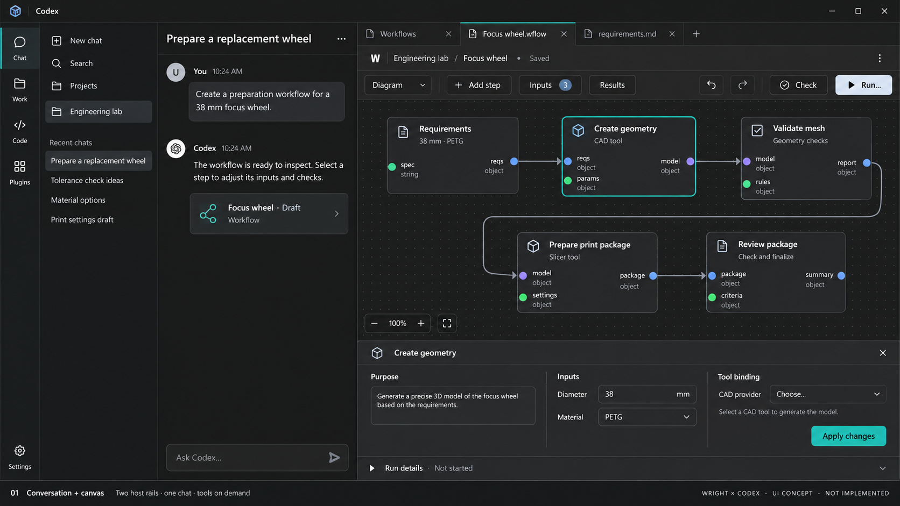
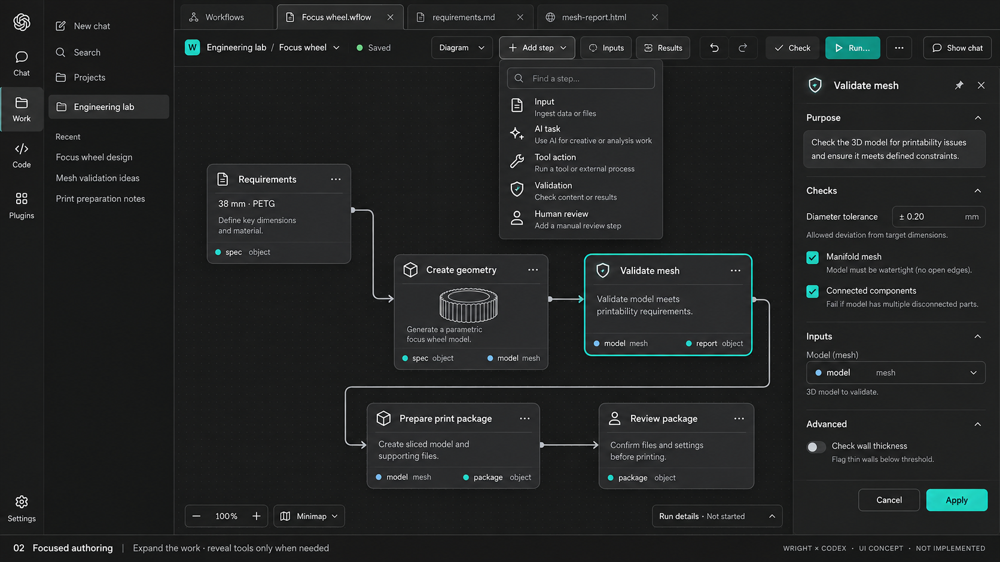
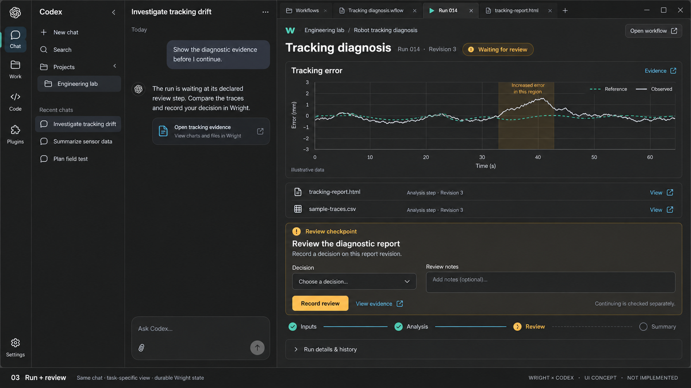

# Wright inside the OpenAI desktop harness: visual exploration

12 October 2026. Three image-generated UI concepts for discussion, before an
implementation plan. These are mockups, not screenshots, implemented behavior,
engineering results or a claim of native panel qualification. “Codex” here means
the OpenAI desktop harness, as requested. Its chrome is an approximation, not a
capture of the user's exact Windows build.

The follow-up [integration plan](integration-plan.md) records the shared-canvas,
host-adaptive controls direction requested after review of these concepts.
The concepts remain mockups; the plan does not claim implementation.

The [experience research task](integration-experience-research.md) now precedes
substantial UI implementation, to test the direction against current integration
patterns, evidence of customer value and usability findings.

User decision, 12 October 2026: adopt the concepts' neutral canvas styling
consistently across all hosts. Keep one shared canvas with preserved editing
behavior; adapt surrounding buttons, widgets and frames to each host.

## Recommended direction

Use **Conversation + canvas** as the default, **Focused authoring** when the
graph needs more room, and **Run + review** while carrying out the job. These
are complementary views of one workspace, accepted workflow and durable run.
Codex supplies the outer navigation, chat and document tabs. Wright supplies
workflow editing, process interactions and exact evidence within the active view.

The two existing host navigation areas stay. Remove Wright's extra persistent
activity rail from the hosted composition. Relocate its functions rather than
discarding them. Keep one document tab strip, one chat composer and one clear
workspace context. A workflow's Diagram/Source selector is a view control, not
another document tab strip.

### 01 — Conversation + canvas

The native conversation remains visible beside the canvas. A selected block
opens a closable bottom inspector, preserving width for the graph. Inputs,
results and adding a step use compact toolbar controls. Run details remain
collapsed until needed. This is the recommended everyday starting layout.

Tradeoff: the bottom inspector consumes canvas height. At short heights it
should open as a temporary sheet or the user should expand the work view; the
graph must not become unreadably small just to fit everything.

### 02 — Focused authoring

The host's full work view gives the canvas more room, with chat available again
through the host. An Add step popover replaces the vertical creation palette.
Only the selected block opens the right inspector; it can be closed. This suits
detailed wiring, typed settings and source comparison.

Tradeoff: chat is temporarily out of view. The inspector should dock at the
right only when sufficient width remains for readable blocks and connections.

### 03 — Run + review

The native chat accompanies a job-oriented working view. Robot Tracking
Diagnosis illustrates a different use case: evidence, an explicit review form,
progress and a link back to the exact workflow. Authoring tools are absent from
this view, but remain available in the workflow document. Recording a review
and qualifying continuation stay distinct.

Tradeoff: the graph is no longer the primary surface. Every result, pending
interaction and diagnostic needs a direct route back to its exact block/run.

## Where current Wright controls would go

| Current surface | Proposed location inside the desktop experience |
| --- | --- |
| Wright chat, session/model controls | Existing desktop conversation and harness controls |
| Workspace dashboard/back navigation | Compact workspace picker; explicit Create workspace action |
| Workflows entry | A Workflows panel entry / library document, offering Create and Open |
| File/document tabs | Host document tabs, subject to actual extension support |
| Workspace files and Git | Host facilities where they expose the same files; keep Wright artifact-specific actions for stored results |
| MCP Tools | Workspace Tools sheet for Wright provider bindings and permissions; harness plugin settings do not replace Wright authority |
| Workspace settings/docs | Workspace menu and contextual help |
| Vertical Create rail | Add step button, searchable popover and contextual insertion |
| Diagram, Source, Side by side | Compact view selector within the workflow document |
| Inputs / Results navigators | Toolbar popovers, with result viewers opened as documents where supported |
| Selected block inspector | Bottom drawer beside chat; optional right dock in wide editing view |
| Instructions, Save, Check, readiness | Reachable workflow actions; overflow only for secondary operations; readiness remains explicit before Run |
| Run details/history | Collapsible bottom drawer or run document, tied to the exact run |
| Common or tailored working UI | Run document, with inputs, evidence and permitted actions suited to the process |

The design retains typed ports/connections, input editing, block configuration,
dragging, pan/zoom, Undo/Redo, source drafts, save/conflict handling, instructions,
readiness and exact result navigation. These capabilities must survive any later
implementation. Native text-file edits must not bypass Wright's accepted-source
validation. Closing a document is not cancelling a run.

## Visual direction

Follow the host's neutral surfaces, system font, spacing, borders, focus states
and light/dark theme. Reserve a small Wright accent for selection and identity;
status also needs readable labels/icons. Avoid bringing the current navy/glow
theme or another application banner into the desktop. Reuse Wright's shared UI
kit with a hosted theme rather than inventing separate control styling per page.
The images explore dark mode only; light mode, keyboard use, text zoom and
narrow widths remain design/validation work.

## What the review actually used

- Feature worktree `/tmp/wright-openai-desktop-harness-prototype-next`, base HEAD
  `c0769319`. Concurrent source work was present and left untouched; this task
  writes only this concept folder.
- Existing served-Wright captures `../../gallery/07-hosted-editor-saved.png`
  and `../../gallery/09-connected-input-ready.png`, inspected visually.
- The recovered canvas-first editor's `north-star.md`, image-led review and
  `docs/contributing/workflow-ui-integration.md`; current `WorkspaceActivityBar`,
  `WorkspacePanel`, `WorkflowRecoveryConcept`, common working-view code and
  `packages/ui_kit/src/tokens.css`.
- Workflow platform vision, refactoring plan, process-app design, engineering
  demonstration principles and Feature 083 plan. Simplified illustration graphs
  do not replace the original engineering examples or their requirements.

## Documented host capabilities versus proposed design

Official documentation describes conversation-panel entrypoints and file
viewers/editors: [Plugin extensions](https://developers.openai.com/plugins/build/extensions).
The desktop documents split/full views and tabs:
[Browser layout](https://learn.chatgpt.com/docs/browser) and
[Commands](https://learn.chatgpt.com/docs/reference/commands).
The shared design guidance recommends host colors, system fonts and offers a
component library: [UI guidelines](https://developers.openai.com/plugins/concepts/ui-guidelines).

Those documents support the direction; they do not establish that this installed
Windows build lets our local plugin create, name, restore and coordinate all the
Wright tabs shown here. The exact `.wflow` editor registration, per-run tabs,
host navigation entry, theme bridge and remote-host resource lifecycle still
need qualification. The earlier successful native MCP tool call proves tool
connectivity only. The UI guidance distinguishes ChatGPT behavior from shared
ChatGPT/Codex tool support:
[Troubleshooting](https://developers.openai.com/plugins/deploy/troubleshooting).

Do not implement a fake host tab strip and describe it as native integration.
If a host capability is absent, discuss the visible fallback explicitly before
turning this visual direction into an implementation plan.

## Shareable concept caption

“Exploring Wright inside the OpenAI desktop harness: one conversation, workflow
documents beside it, and engineering tools that appear when needed. These are
UI concepts—the native panel experience is still being prototyped.”

The footer labels should stay visible when sharing. All chat text, graphs,
metrics, tolerances, file names and review/run states shown in these images are
illustrative, not verified engineering evidence or newly accepted requirements.
Nothing was published. Images were created with the built-in image generation
tool; the complete generation prompts are saved in [prompts.json](prompts.json).

Design discussion to settle before planning: whether the bottom inspector feels
natural beside chat; whether Workflows should be the first opened document; and
which results deserve their own document rather than an inline preview.
