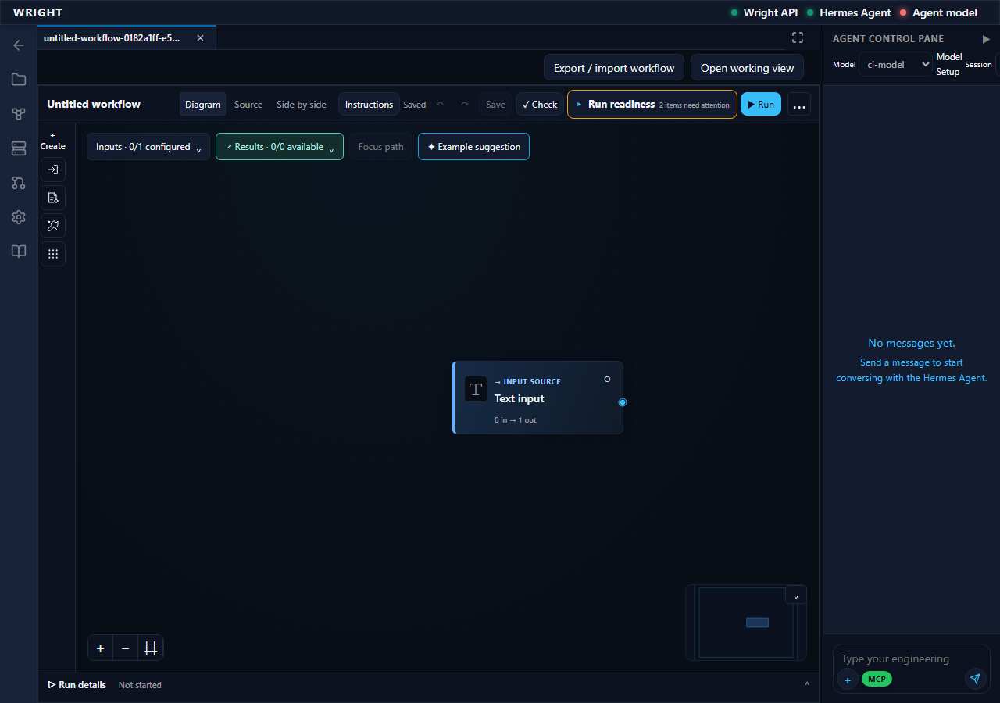

# Packaged workflow authoring and model-profile repair

**Verified:** 11 October 2026 UTC. **Source:** `41ec46f5931aba28a8e4bac0aa59e703599649e9`.

## What a user can now do

The ordinary packaged workspace's **Workflows** control opens a blank process.
Add **Text input**, save, and refresh: the same source and block return without
starting execution. Open the Agent pane to see the model resolved from setup's
named Hermes profile. The SDK path explains that intentional model changes belong
in **Model Setup** before starting a new run.

This screenshot uses an isolated synthetic `ci-model` configuration with an
unreachable inference endpoint. Its red Agent model health indicator is expected;
model discovery is not a claim of provider reachability or live inference.

## Reproduced problem and existing owner

The earlier `a1cb7218` candidate's SDK transport check passed with a prepared
temporary profile. Normal Docker startup nevertheless returned HTTP 503 for
model discovery: setup seeded the named `wright` profile, while the confined SDK
worker read the empty root model configuration. Matching root/profile values in
the first fixture hid the scope defect.

The existing adapter worker now uses Hermes's official profile resolver and
credential loader before importing its model resolver. Only the child environment
changes. No project dotenv, full agent executor or independent status owner is
introduced. Missing profiles fail without fallback, credentials stay local, and
bootstrap source identities join frozen SDK qualification. Earlier routes cannot
silently acquire the changed bootstrap. Backend validation, dispatch and review
authority remain unchanged.

## Evidence and limits

- 38 focused and 446 complete adapter regressions pass. A final committed-worker
  check passes 33 affected cases after aligning profile whitespace handling.
- The clean Git-archive image is `wright:dev-candidate-41ec46f5931a`, immutable ID
  `sha256:0154d75b851a3e6fb9df539fe5fa967c6f193a2dd9706c20702b277af647e6e4`.
- Its installed adapters and stock Hermes pass `scripts/test-hermes-workflow-sdk.py`
  with no adapter overlay: three explicitly synthetic loopback requests, different
  root/profile models, a profile-only private key, text/image input, a validated
  tool proposal, failed-request evidence and changed-route rejection. No MCP
  operation or real inference occurs.
- The normal packaged UI walkthrough passes all five steps, with no console,
  page or failed HTTP diagnostics and no run/review/dispatch submission. Its
  report structure validates, and the final screenshot was visually inspected.
  [Recorded steps](../../../artifacts/process-interfaces/083/20261011-packaged-model-profile/walkthrough-status.json),
  [illustrated walkthrough](../../../artifacts/process-interfaces/083/20261011-packaged-model-profile/report.html),
  [model response](../../../artifacts/process-interfaces/083/20261011-packaged-model-profile/model-discovery.json),
  [exact workspace/source observation](../../../artifacts/process-interfaces/083/20261011-packaged-model-profile/observations.json).
- Private traces, authentication context and full failed/successful walkthrough
  records remain in ignored `.local-run/dev-delivery`; credentials are not shared.
  The earlier failures are preserved. The first repair diagnostic mounted the
  wrong import path and failed; the corrected diagnostic passed before the clean
  image qualification. A silent sandbox test was deliberately closed after
  process reconciliation; separately authorized test runs supply the pass evidence.

These checks establish packaged authoring, discovery and confined SDK mechanics.
They do not establish native-host default routing, actual model quality, complete
engineering execution, human acceptance or the full development gate. The 130 mm
study remains untouched by this proof. Development delivery and the full
engineering goal remain open; presentation work is deferred.
